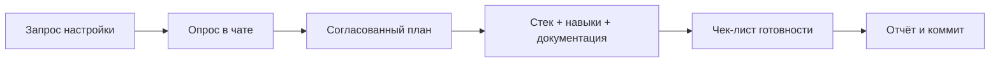

# Go Product Platform — разработка с AI-агентами

Стартовый набор для разработки продуктов на Go вместе с ИИ-агентами (Codex, Claude Code, Zed, Orca).

**Что внутри:** курируемые навыки агентов (Go, PostgreSQL, Protobuf/Buf, Wails, React/shadcn, тестирование, AI SDK), руководство по архитектуре и разработке — всё в виде Markdown-документов с YAML frontmatter, связанных гиперссылками и mermaid-диаграммами.

**Зачем:** новый проект настраивается за один разговор с агентом — без ручных команд и без исполняемого установщика. Последовательность настройки описана в документах, агент выполняет её своими инструментами и подтверждает план у пользователя. Согласованный набор навыков, агентов и референсов копируется в `.agents` и `.claude` продукта и хранится в Git. Проектные версии имеют приоритет; источники и ревизии фиксируются в реестре набора.

## Принципы

- **Только Markdown.** Платформа — коллекция md-документов с YAML frontmatter; исполняемых скриптов установки нет. Правка последовательности или состава настройки — правка текста документа.
- **Гиперссылки вместо реестров.** Документы связаны ссылками: навык → критерии → источники → шаблоны → реестр продукта. Агент находит нужное переходами по ссылкам.
- **Диаграммы для последовательностей.** Каждая чёткая последовательность действий сопровождается mermaid-диаграммой: [процесс настройки](platform/skills/go-platform-bootstrap/references/product-setup.md#процесс-настройки), [инициализация репозитория](platform/skills/go-platform-bootstrap/references/product-setup.md#инициализация-репозитория-продукта), [цикл управления набором](platform/project-skill-templates/go-project-platform-manager/SKILL.md).
- **Агент — исполнитель, человек — решение.** План настройки, глобальные установки и обновления навыков требуют подтверждения в чате; low/medium-шаги в согласованном объёме агент проходит сам.

## Процесс разработки (SDD)

Последовательность: требования → дизайн → план → реализация → проверки →
независимое ревью → готовность — как правила продукта, без исполняемых ворот.

- HLD/LLD/ADR/контракты/SPEC/долг/инициативы — в Git продукта под `docs/`; артефакты — Markdown с YAML frontmatter ([контракт, глава 20](platform/handbook/docs/20-artifact-contract.md)).
- Готовность подтверждается свежими проверками, независимым ревью и зафиксированным в Git кандидатом.
- Высокий риск и выпуск требуют фактического решения человека.

Начать: [SDD-процесс](platform/handbook/docs/19-agent-sdd.md),
[контракт артефактов](platform/handbook/docs/20-artifact-contract.md).

## Стандарт продуктового репозитория

Каждый продуктовый репозиторий должен использовать **структуру документации и workflow
этой платформы**: [процесс разработки](platform/handbook/docs/19-agent-sdd.md) и
[структуру и контракт документов](platform/handbook/docs/20-artifact-contract.md).
Правила продукта — `docs/workflow.md`; HLD/LLD/ADR, семантика контрактов, SPEC,
долг и инициативы — в отслеживаемом `docs/` (структура — глава 20). Обоснованные
адаптации фиксируются в workflow продукта. Отсутствующие базовые документы агент создаёт из
[шаблонов](platform/templates/), сохраняя существующие.

[Graphify](https://github.com/Graphify-Labs/graphify) входит в набор по умолчанию
**каждого** профиля, включая `custom`. При настройке агент устанавливает
отсутствующий инструмент глобально (`uv tool install graphifyy`) и включает навык
в набор. Выбор профиля сам по себе не устанавливает инструмент.

Для UI/фронтэнда при настройке можно подключить
[app-canvas](https://gitlab16.skiftrade.kz/design/app-canvas): агент сам клонирует
и проверяет источник по [инструкции canvas](platform/references/canvas-installation.md).
Поддерживаются новое UI-приложение и подключение существующего.

## Сценарий настройки нового проекта

Откройте **целевой продуктовый репозиторий** и вызовите скилл одним запросом:

```text
/go-platform-bootstrap Подготовь этот проект к разработке
```

Дальше агент проводит опрос **в чате**, по одному вопросу:

1. С чего начать: подготовить проект к разработке без описания продукта,
   описать идею несколькими предложениями или разобрать готовые требования
   из прикреплённых документов и ссылок.
2. Для идеи — уточнить первую версию; для готовых требований — прочитать источники,
   показать понимание, разобрать противоречия и получить подтверждение пользователя.
   При подготовке технической основы описание бизнес-функций не требуется.
3. Где должен работать продукт: браузер, desktop, mobile или API.
4. Подходит ли предложенный стек и локальное окружение.
5. Нужны ли дополнительные возможности, например AI или UI canvas.
6. Можно ли проверить уже установленные инструменты и глобальные навыки.
7. Согласовать таблицу навыков (назначение, источник, ревизия, пути), списки агентов
   и референсов и применить итоговый план настройки.



Пользователь отвечает на вопросы. Агент сам выбирает профиль, составляет план,
выполняет установку стека, навыков и документации и проверяет готовность по
[чек-листу](platform/skills/go-platform-bootstrap/references/product-setup.md#критерии-готовности).
Технические имена профилей знать не требуется. Найденные в репозитории
решения агент учитывает, без повторного опроса; существующий код сохраняет.
Все три пути завершаются установкой выбранной основы и проверкой готовности.
Подготовка проекта не очищает репозиторий и не реализует все функции продукта.

`/go-platform-bootstrap` — форма вызова для ADE с поддержкой slash-skills.
В Codex используйте `$go-platform-bootstrap Подготовь этот проект к разработке`
или выбор скилла: дальнейший опрос тот же.

Последующие запросы вроде «Проверь готовность проекта» или «Проверь обновления
используемых навыков» выполняются без повторения полного опроса.

## Установка платформы

- **Через агента (основной путь):** попросите агента выполнить начальную настройку
  из доверенного клона этого репозитория. Агент скопирует навык `go-platform-bootstrap`
  и `go-project-platform-manager` в `~/.agents/skills` и `~/.claude/skills`
  вместе с полным снимком материалов и проверкой перенесённых ссылок
  по [инструкции установки](platform/references/bootstrap-installation.md).
- После этого откройте любой Git-продукт в ADE с поддержкой этих каталогов и
  вызовите `/go-platform-bootstrap …`. При необходимости обновите список skills/
  перезапустите агент ADE. Для Orca/Zed доступность зависит также от выбранного
  агента и его поддержки Agent Skills.

## Расположение

```text
/Users/olegkrasnov/
  .agents/skills/                 # глобальные навыки Codex/Zed
  .claude/skills/                 # глобальные навыки Claude

my-product/
  AGENTS.md, CLAUDE.md, MANUAL.md, .gitignore
  .agents/{skills,agents,references}/  # проектные материалы в Git
  .claude/{skills,agents,references}/  # те же материалы для Claude
  docs/{workflow,agent-skills}.md      # правила процесса и реестр набора
  docs/{hld,lld,adrs,specs,debt,initiatives}/  # архитектура, спецификации, долг
  graphify-out/                        # генерируемый граф (gitignored)
```

## Материалы платформы

[Карта материалов](platform/README.md) · [История изменений](CHANGELOG.md) ·
[Прежнее дополнение](addendum.md) · [Краткий LOCAL-NATIVE старт](platform/references/local-native.md)


| Путь | Описание |
|---|---|
| [platform/skills/go-platform-bootstrap/](platform/skills/go-platform-bootstrap/SKILL.md) | Навык начальной настройки: SKILL.md, опросник, подготовка продукта, источники навыков, операции агента, примеры AGENTS.md/CLAUDE.md |
| [platform/project-skill-templates/go-project-platform-manager/](platform/project-skill-templates/go-project-platform-manager/SKILL.md) | Шаблон проектного управляющего навыка: цикл установки, выбора и обновления набора |
| [platform/templates/](platform/templates/) | Шаблоны init-документов и пример CI; состав и границы — [templates/README.md](platform/templates/README.md) |
| [platform/handbook/](platform/handbook/) | Руководство (канонический Markdown) |
| [platform/references/](platform/references/) | Инструкции установки платформы, ADE и canvas |
| [platform/constitution.md](platform/constitution.md) | Инженерные инварианты |

## Сопровождение и качество

Валидация платформы — консистентность документов: перекрёстные ссылки, актуальность
ревизий в [каталоге источников](platform/skills/go-platform-bootstrap/references/skill-sources.md),
соответствие примеров и шаблонов. Для Graphify требуются Git и uv; для навыков Orca — Orca или npx.

Подробную информацию об установке смотрите в
[bootstrap-installation.md](platform/references/bootstrap-installation.md) и
[ade-installation.md](platform/references/ade-installation.md).

## Проектные агентные материалы

Состав набора согласуется в чате: агент показывает таблицу навыков, агентов и
референсов с источниками, ревизиями и путями установки в оба каталога. После
согласования копирует материалы в `.agents/` и `.claude/` продукта и фиксирует
набор в реестре `docs/agent-skills.md`. Глобальная установка
отсутствующих источников выполняется отдельно до копирования. Повторная
инициализация материалов не требуется: проектные копии приходят из Git.

В `AGENTS.md` и `CLAUDE.md` на русском явно обязателен флоу
software-development-workflow. Сам стандарт с шаблонами устанавливается из
зафиксированной ревизии репозитория, указанной в
[каталоге источников](platform/skills/go-platform-bootstrap/references/skill-sources.md).
`MANUAL.md` содержит настройку, окружение, запуск и проверки продукта; агент
дополняет её проверенными командами конкретного продукта.
Изменённые вручную проектные навыки не перезаписываются.
