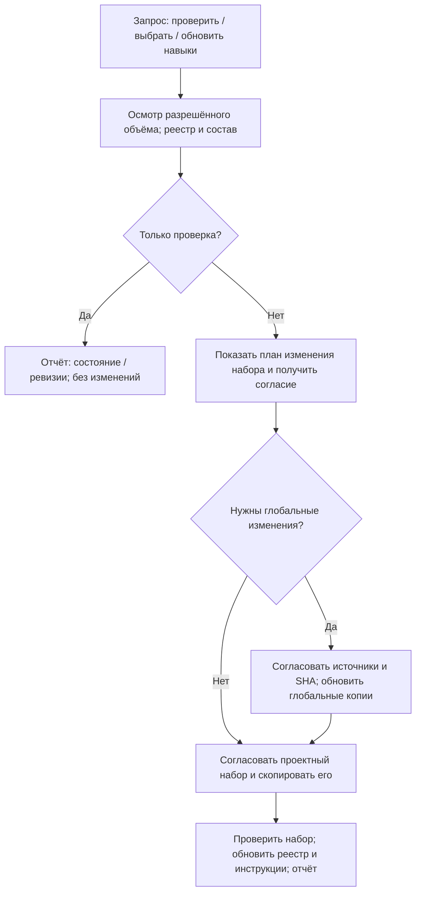

# Go Product Platform — управление навыками проекта

Этот навык установлен в `.agents/skills` и `.claude/skills` продукта. Проектные
навыки, роли и референсы отслеживаются в Git и имеют приоритет над глобальными
версиями. Обязательно соблюдайте software-development-workflow из
`.agents/references/software-development-workflow/docs/workflow.md`.

Платформа не имеет исполняемого установщика: состав набора фиксирует реестр
`docs/agent-skills.md`, а все действия (осмотр, копирование, обновление)
выполняет агент своими инструментами с подтверждением пользователя в чате.

## Цикл работы с набором

## Работа через агента (пользователь не вводит команды оболочки)

Для запроса только на проверку выполняйте лишь чтение и отчёт: пункты о выборе,
установке и обновлении пропускаются. Проверять upstream только по запросу актуальности.
Уже согласованные действия повторного подтверждения не требуют.

1. Прочитайте текущий состав из реестра `docs/agent-skills.md`.
   Не предполагайте, что все глобально доступные навыки входят в набор проекта.
2. Объясните доступные категории: Go, API/Buf, React/UI, тестирование, Wails,
   нативные мобильные приложения, AI, Orca/Graphify. Запросите согласие
   **до проверки глобальных каталогов навыков пользователя**.
3. После согласия осмотрите `~/.agents/skills/` и `~/.claude/skills/` и простыми
   словами перечислите установленные, отсутствующие и выбранные навыки.
   Не раскрывайте посторонние личные файлы.
4. Предложите профиль по [product-setup.md](../../skills/go-platform-bootstrap/references/product-setup.md)
   и изменения списка навыков. **Запросите подтверждение перед изменением.**
   Составы профилей — данные в этом документе; правьте их там при согласовании.
5. Если выбранные навыки отсутствуют глобально, покажите точные источники из
   [skill-sources.md](../../skills/go-platform-bootstrap/references/skill-sources.md)
   и запросите отдельное согласие на глобальную установку. Затем скопируйте навыки
   в `~/.agents/skills/` **и** `~/.claude/skills/` на согласованных ревизиях,
   не перезаписывая существующие. Для Orca используйте официальный установщик Orca,
   для Graphify — `uv tool install graphifyy`. После подготовки источников покажите
   план копирования в продукт: навыки, назначение, источник/ревизия, пути, агенты
   и референсы. Установите одобренный набор в `.agents/` и `.claude/` продукта.
6. Только если пользователь просит проверить актуальность или принимает явное
   предложение такой проверки, сравните ревизии источников с реестром (локальные
   клоны или `git ls-remote`). Сообщите прежнюю и предлагаемую ревизию и влияние
   изменения. Сама проверка ничего не изменяет.
7. Перед глобальным обновлением объясните, что **оно может затронуть все проекты
   на компьютере**. Получите явное согласие на перечисленные источники и ревизии.
   Проверьте новые скрипты и исполняемые инструкции. Затем обновите глобальные
   копии и зафиксируйте прежние снимки до успешной замены.
8. Для обновления навыков Orca после одобрения предпочитайте собственный механизм
   Orca; для Graphify после одобрения используйте `uv tool upgrade graphifyy`.
   Не предполагайте, что ревизии Git охватывают эти независимые инструменты.
9. Проверьте результат: `SKILL.md` каждого навыка реестра присутствует в обоих
   каталогах продукта, реестр соответствует факту, глобальные копии согласованы.
   Перечислите изменённые отслеживаемые файлы, ревизии, отсутствующие инструменты
   и неустранённые риски.

## Правила

- **Никогда** не обновляйте, не заменяйте, не удаляйте и не активируйте навыки без
  уведомления пользователя. Простая просьба *проверить* не разрешает установку
  или обновление.
- Активация для проекта — это изменение реестра `docs/agent-skills.md`
  и копирование файлов в `.agents/` и `.claude/`; глобальные каталоги меняются
  только отдельным решением.
- Не публикуйте предметные навыки проекта глобально без отдельного явного запроса.
- Никогда не запускайте неизвестные сторонние скрипты навыков автоматически и не
  передавайте им секреты рабочей среды.
- Отслеживаемые файлы `AGENTS.md` / `CLAUDE.md` — точка обнаружения навыка.
  Проектные копии не зависят от последующих глобальных обновлений.
- Работа в новом worktree не требует установки: `.agents/` и `.claude/`
  отслеживаются Git. Восстановите только генерируемые материалы (граф graphify),
  которые каждое дерево строит само.

## SDD и документация продукта

Для полной настройки стека используйте глобальный `go-platform-bootstrap`.
Критерии готовности и составы профилей —
[product-setup.md](../../skills/go-platform-bootstrap/references/product-setup.md);
проверки выполняет агент по чек-листу готовности с фактическими командами
продукта. Уже разрешённый пользователем план не требует повторного подтверждения
каждого входящего в него действия.

При новой фиче читать `docs/workflow.md`, затем релевантные HLD/LLD и SPEC.
До реализации зафиксировать requirements с AC-ID, затем design и plan с вертикальными
срезами-задачами; артефакты — обычный Markdown с YAML frontmatter (главы 19–20
руководства). Завершая срезы, запускать реальные проверки
и фиксировать команду и результат в verification.md; обновлять affected_docs.
Перед слиянием — независимая сессия ревью и зафиксированный в Git кандидат.
Не выдавать старые отчёты за свежие и не приписывать себе одобрения. Высокий риск и выпуск
требуют фактического решения человека; low/medium шаги в согласованном объёме
агент проходит сам согласно workflow продукта. Не устанавливать для этого дубликаты
глобальных навыков. При миграции сохранить пользовательские документы; несовместимый
формат согласовать.

## Обязательная основа и опциональный UI canvas

- Каждый продукт использует структуру документации и workflow этого репозитория
  (главы 19–20). Документы продукта — в отслеживаемом `docs/`; адаптации записать
  в `docs/workflow.md`. При инициализации существующие документы
  не перезаписывать; шаблоны — в `templates/` материалов платформы.
- Graphify из https://github.com/Graphify-Labs/graphify — навык по умолчанию для
  любого проекта, включая custom. При настройке включить его в предлагаемый набор
  и установить отсутствующий глобально (`uv tool install graphifyy`).
- Для UI/фронтэнда предложить app-canvas из https://gitlab16.skiftrade.kz/design/app-canvas.
  Читать [canvas-installation.md](../../references/canvas-installation.md) в материалах
  платформы. После проверки локального клона и согласования плана агент сам
  создаёт `.canvas/` и `design/`; для существующего приложения подключает его без
  генерации нового. Проверить `.canvas/board.py doctor`.
  Дизайн-пакет `design/` дополняет SPEC продукта; не заменять им инженерную документацию.

Обновляйте корневой MANUAL.md с фактическими командами настройки, запуска и проверок;
проверьте AGENTS.md и CLAUDE.md: русское обязательное указание
software-development-workflow и проектных навыков.
