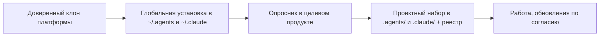

# ADE: установка и управление навыками ИИ

Как агентские среды (ADE) — Codex, Claude Code, Zed, Orca — находят навыки
платформы и как устроен их жизненный цикл. Порядок установки платформы и
настройки продукта описан в
[bootstrap-installation.md](bootstrap-installation.md); этот документ — про
расположение наборов и границы операций.

## Каталоги навыков

| Расположение | Назначение |
|---|---|
| `~/.agents/skills/` | Глобальные навыки для Codex, Zed и совместимых сред |
| `~/.claude/skills/` | Те же глобальные навыки для Claude Code |
| `<продукт>/.agents/skills/`, `.claude/skills/` | Проектный набор под Git; имеет приоритет над глобальными |
| `<продукт>/docs/agent-skills.md` | Реестр набора продукта: состав, источники, ревизии |

Глобальная установка — одна на машину: копирование навыков из доверенного клона
в оба каталога (порядок — [bootstrap-installation.md](bootstrap-installation.md)).
Обнаружение глобальных Agent Skills зависит от ADE: поддержку нужно проверить
в выбранной среде; возможно, потребуется перечитать список навыков или
перезапустить агента.

## Жизненный цикл

После настройки проекта запросы вроде «какие навыки у нас есть», «включи
тестирование», «проверь обновления» обслуживает проектный навык
`go-project-platform-manager` (описан в самом продукте:
`.agents/skills/go-project-platform-manager/SKILL.md`).

## Разрешения и границы

- Изменения глобальных каталогов — только после явного согласия; просьба
  «проверить» не разрешает установку или обновление.
- Состав набора продукта фиксирует реестр `docs/agent-skills.md`;
  проектные копии имеют приоритет и не меняются от глобальных обновлений.
- Скрипты сторонних навыков не запускаются автоматически.
- Работа в worktree не требует установки: `.agents/` и `.claude/` приходят из
  Git; каждое дерево само строит генерируемые материалы (граф graphify).

## Обновления

Проверка обновлений — только чтение: сравнение ревизий реестра с источниками
(локальные клоны или `git ls-remote`). Применение — отдельная согласованная
операция: глобальное обновление затрагивает все продукты машины. Прежние снимки
сохраняются до успешной замены; при конфликте с существующим навыком установка
останавливается без перезаписи. Orca и Graphify обновляются собственными
официальными механизмами. Новые имена навыков добавляются правкой
[каталога источников](../skills/go-platform-bootstrap/references/skill-sources.md),
а не непроверенным автоматическим поиском.
