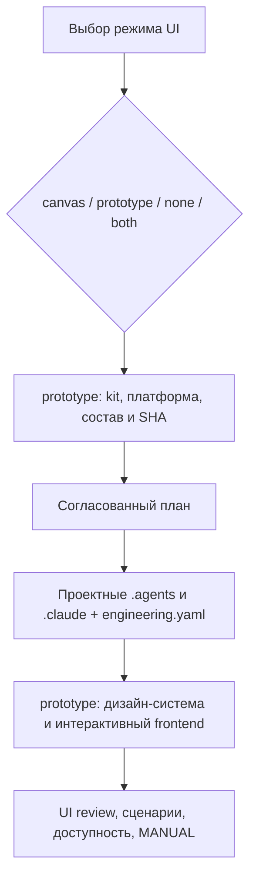
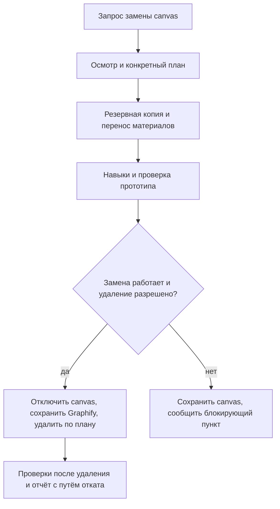

# Скиллы для разработки прототипов

Альтернатива app-canvas для продукта с UI — **Production-Ready Interactive
Prototyping**: полноценный интерактивный frontend без backend на целевом стеке
продукта. Прототип — первая версия продукта: после проверки UX mock-адаптер
заменяется реальным API, добавляются авторизация и бизнес-логика. Это направление
переиспользования кода, а не заявление о production-готовности прототипа.

При настройке предложить один режим: `canvas`, `prototype` или `none`.
`none` сохраняет обычную настройку UI. Оба инструмента подключать только по явному
выбору `both`, определив, какое приложение и дизайн-система являются основными.
Обычная смена режима не удаляет существующие `.canvas/`, `design/` или `prototype/`.
Для явного запроса «убрать canvas и заменить прототипами» выполнить
[сценарий миграции](#замена-canvas-на-прототипы).

## Установка проектного набора

1. Проверить выбранную платформу, существующий UI kit, дизайн-систему и каталог
   `prototype/`. При наличии приложения согласовать переиспользование компонентов
   и токенов; не создавать конкурирующую библиотеку и не перезаписывать файлы.
2. Выбрать основу и платформенные дополнения из
   [каталога источников](../skills/go-platform-bootstrap/references/skill-sources.md#скиллы-для-разработки-прототипов).
   Показать конкретные имена навыков, назначение, источник, SHA, пути и зависимости.
   Имя репозитория не считать именем навыка: прочитать README и `SKILL.md`
   выбранной ревизии, проверить относительные ссылки, assets и scripts.
3. После согласования копировать выбранные навыки из временных клонов на
   зафиксированных SHA непосредственно в `.agents/skills/` и `.claude/skills/`
   **корня продукта**, вместе с необходимыми ресурсами. Глобальная установка
   не обязательна. Примеры `npx skills add ... -g` означают глобальную установку
   и в этом режиме не применяются. Не устанавливать все навыки репозитория вслепую.
   Внешние симлинки заменить переносимыми проектными файлами; сохранить лицензии.
4. Записать каждый навык в `engineering.yaml`: name, source, revision, paths,
   purpose, status. Для локального Impeccable записать контрольную сумму снимка.
   Совпадающие имена и изменённые проектные копии не перезаписывать: показать diff
   и согласовать обновление. Уже установленный shadcn или reviewer не дублировать.
5. Добавить в `AGENTS.md` маршрутизацию: UI kit и `prototype/DESIGN.md` → дизайн
   и реализация → UI review → браузерная проверка. `CLAUDE.md` ссылается на эти
   правила. Скопировать этот референс с материалами платформы. Записать выбранный
   режим, kit и путь приложения в `engineering.yaml`, команды — в `MANUAL.md`.
6. Проверить обнаружение навыков в обеих ADE, полноту ресурсов, отсутствие
   внешних ссылок файловой системы и совпадение проектных копий. Скрипты навыков
   не запускать автоматически. CLI agent-browser и браузерные бинарники — отдельные
   зависимости плана: наличие навыка ещё не означает готовность инструмента.



Установку навыков и создание приложения различать в плане: запрос только на
навыки не запускает генерацию приложения. При подготовке приложения без описания
продукта создать технический smoke-сценарий, не придумывать бизнес-требования.

## Стек и структура прототипа

Для нового web или webview desktop прототипа рекомендуемый стек:

| Задача | Технология | Назначение |
|---|---|---|
| Приложение | React + TypeScript + Vite | Полноценные пользовательские сценарии |
| UI kit | shadcn/ui + Base UI | Переиспользуемые компоненты |
| Дизайн-система | Tailwind CSS v4 + semantic design tokens | Единые цвета, типографика, отступы, состояния |
| Навигация | TanStack Router | Реальные маршруты и переходы |
| Данные | TanStack Query | Общий слой запросов для mock и API |
| Таблицы | TanStack Table / Virtual | По потребности: таблицы и большие списки |
| Формы | React Hook Form + Zod | Ввод и валидация |
| Mock API | MSW или in-memory adapter | Работа без backend |
| Каталог компонентов | Storybook | Компоненты, состояния и визуальные проверки |
| Проверки | Playwright + axe-core | Сценарии и автоматические проверки доступности |
| Визуальное качество | Impeccable + UI Reviewer | Дизайн и отдельный проход ревью |

Версии зависимостей и совместимость выбранного пресета shadcn с Base UI проверять
при установке по официальной документации; сохранять lockfile. Существующий kit
не мигрировать автоматически. Здесь UI kit означает библиотеку компонентов;
для native iOS UIKit/SwiftUI и Android Compose использовать целевой native стек.
React-прототип не обещает переиспользования frontend-кода в native приложении.
Desktop Taste дополняет дизайн desktop; Wails и интеграцию с ОС проверять отдельно
в настоящем окне приложения, а не только в браузере.

```text
prototype/
  DESIGN.md             # kit, токены, типографика, состояния, правила движения
  README.md             # сценарии, mock-режим, ограничения, ссылки на SPEC
  src/
    app/                # маршруты и провайдеры
    components/         # композиции поверх выбранного kit
    features/           # экраны и пользовательские сценарии
    data/               # интерфейс данных, mock и будущий API adapter
    styles/             # токены и общие стили
  .storybook/           # если включён каталог компонентов
  tests/                # сценарии и доступность
```

Код UI не должен напрямую зависеть от фикстур: данные поступают через единый
интерфейс; задержки, ошибки и изменения данных моделируются в mock-слое.
Mock-режим включается явно и не попадает в production по умолчанию. Storybook
не заменяет приложение: полный путь пользователя демонстрируется через Vite.
Для существующего монорепозитория использовать общие пакеты компонентов/токенов.

## Процесс и готовность

Изменение поведения или контрактов проходит SDD: ссылки из
`prototype/README.md` на `docs/specs/<SPEC-ID>/` и T-XX; обратные ссылки из SPEC
на экраны, DESIGN.md и проверки. `tasks.md` остаётся единым списком задач.
Косметическое изменение проходит дизайн и ревью без обязательной новой SPEC.

Готовность подтверждается фактическими результатами:

- Приложение запускается без backend; основной сценарий, переходы, формы и
  изменения данных работают, предусмотрены loading, empty, error и success.
- Компоненты используют выбранный kit и семантические токены; проверены размеры
  экрана, клавиатура, фокус, контраст и reduced motion.
- Typecheck и production build проходят; Playwright проверяет основной сценарий
  и ошибку/повтор запроса, axe-core — ключевые экраны. Автоматический аудит
  дополнен ручной проверкой клавиатуры и визуальным просмотром.
- UI Reviewer выполняет отдельный проход по работающему интерфейсу; замечания,
  исправления и оставшиеся ограничения записаны в `review.md` соответствующей SPEC
  (или в README прототипа для косметики). В `verification.md` — команды и результаты.
- `MANUAL.md` содержит проверенные команды установки, запуска, build, тестов,
  Storybook (если выбран), переключения mock/API и фактический локальный адрес.

При установке только навыков проверить проектный набор и явно сообщить, что
приложение и UI-проверки ещё не подготовлены. Worktree получает навыки и исходники
из Git; зависимости восстанавливаются по lockfile без обновления набора.

## Замена canvas на прототипы

Точка входа — `go-project-platform-manager`. Запрос «убрать canvas и заменить
его разработкой UI через прототипы» означает миграцию, а не только смену `ui.mode`.
Агент выполняет работу сам. Простой выбор `prototype` или запрос «проверить»
не разрешает удаление canvas. Уже согласованный перечень действий повторного
подтверждения не требует; неопределённые пользовательские данные сохраняются.

### 1. Инвентаризация и план

Прочитать `engineering.yaml`, инструкции ADE и MANUAL; проверить Git status,
отслеживаемые, неотслеживаемые и игнорируемые файлы. Найти `.canvas/`, `design/`,
реальное приложение и его связь с canvas, адаптеры/навыки в обеих ADE,
package scripts, зависимости, lockfile, CI, `.gitignore`, `.graphifyignore`,
ссылки из SPEC и команды запуска. Искать также в скрытых конфигурациях;
не выводить секреты и не считать все файлы `design/` служебными.

Проверить `git worktree list`, эффективный `core.hooksPath` с источником настройки,
`git rev-parse --git-path hooks` и обработчики по
[правилам Graphify](graphify-installation.md#3-git-хуки-и-canvas).
Отличать локальные файлы текущего дерева от общих hooks/config и симлинков.

Показать конкретный план таблицей:

| Объект / фактический путь | Действие | Куда переносится / резервная копия | Проверка |
|---|---|---|---|
| Брифы, токены, изображения, решения | Перенести или сохранить | DESIGN.md, README, assets либо архив | Содержимое и ссылки SPEC сохранены |
| Приложение и общие компоненты | Переиспользовать | `prototype/` или существующий пакет | Сценарии и сборка |
| Canvas runtime и адаптеры | Удалить после проверки замены | Внешняя резервная копия | Нет активных вызовов |
| Хуки, scripts, CI, инструкции | Убрать только интеграцию canvas | Копия исходной конфигурации | Graphify и другие обработчики работают |

Заполнить таблицу обнаруженными путями, перечислить точный объём удаления,
выбранные навыки/SHA, создание или перенос приложения и команды проверки.
При недостаточно определённом разрешении подготовить переносимые материалы
и diff, затем согласовать конкретное удаление перед его выполнением.
Не выдавать типовую таблицу за результат осмотра.

### 2. Подготовка замены и восстановления

- Сохранить резервную копию изменяемых локальных/игнорируемых файлов canvas,
  хуков и конфигурации вне удаляемых каталогов и вне отслеживаемого дерева.
  Записать абсолютный путь, исходную ревизию Git и перечень файлов; проверить,
  что копия читается и соответствует исходникам. Незакоммиченные изменения
  сохранять отдельно: одного SHA для восстановления недостаточно.
- Установить проектные навыки по инструкции выше, перенести дизайн-решения
  в `prototype/DESIGN.md`, сценарии и связи с SPEC — в `prototype/README.md`,
  нужные ресурсы — в соответствующие каталоги. Обновить обратные ссылки SPEC.
  Не создавать второй список задач. Исторические брифы можно оставить как
  явно обозначенный архив без зависимости от runtime canvas.
- Существующее приложение переиспользовать; перенос в `prototype/` выполнять
  с исправлением импортов, workspace-путей и команд. Если оно остаётся в прежнем
  пакете, записать реальный `ui.prototype_path` и причину в MANUAL; не создавать
  фиктивную копию приложения. Существующий `prototype/` объединять без перезаписи.
- Проверить замену до удаления: запуск без canvas/backend, основной сценарий,
  typecheck/build, Playwright/axe-core и UI review по критериям выше. Если запрос
  ограничен сменой инструментов без приложения, проверить навыки и маршрутизацию,
  сохранить исходники UI и явно указать эту границу готовности.

### 3. Отключение и удаление canvas

После успешной проверки замены выполнить разрешённый план:

1. Остановить только подтверждённый процесс canvas текущего проекта; не завершать
   все Python/Node-процессы. Убрать его автозапуск, scripts и CI-вызовы.
2. В эффективных хуках удалить только вызовы/блоки canvas. Сохранить Graphify,
   другие обработчики, executable-биты, аргументы, stdin и обработку ошибок.
   Не сбрасывать `core.hooksPath` и не удалять dispatcher целиком. Если общий
   обработчик нужен другим worktree/репозиториям, сохранить его для них и
   отключить canvas только для мигрируемого дерева. Не менять общие настройки
   за пределами согласованной области; нерешённую общую зависимость отметить явно.
3. Удалить только перечисленные в плане runtime-файлы `.canvas/` и исключительно
   canvas-адаптеры/навыки из обеих проектных ADE. Общие навыки и глобальные
   установки сохраняются. Симлинк удалять как ссылку, не удаляя внешний target.
   `design/` удалять только после переноса/архивации всех нужных материалов и
   проверки ссылок; сам каталог не является признаком ненужных данных.
4. Убрать неиспользуемые canvas-зависимости штатным package manager с обновлением
   lockfile; сохранить общие зависимости приложения. Удалить только относящиеся
   к canvas правила ignore, устаревшие команды и обязательные проверки doctor.
5. Обновить `engineering.yaml`: `ui.mode: prototype`, фактический путь и kit,
   новые навыки с ревизиями; убрать записи только реально удалённых материалов.
   Обновить AGENTS.md, ссылку/дополнения CLAUDE.md и MANUAL: UI-задачи направляются
   в прототипирование, ревью не требует canvas-review. Общие материалы платформы
   с описанием альтернативного canvas сохраняются.

### 4. Приёмка и откат

Повторить затронутые проверки после удаления. Проверить активные инструкции,
хуки, package scripts и CI на оставшиеся вызовы `.canvas/`, `board.py`,
`canvas-review` и обнаруженных адаптеров. Упоминания в истории, архиве и справочниках
платформы допустимы, но не должны запускать canvas или требовать его наличия.
Проверить ссылки из SPEC, обнаружение навыков обеими ADE и запуск приложения.
Подтвердить выполнение обработчиков Graphify и остальных хуков по его инструкции;
одного отсутствия canvas в тексте хука недостаточно.

В отчёте указать перенесённые/сохранённые/удалённые пути, результаты проверок,
путь резервной копии и ограничения других worktree. При сбое остановить удаление,
сохранить резервную копию и сообщить частичный результат. Откат восстанавливает
только затронутые миграцией файлы, хуки, настройки и прежний UI-режим из копии
и зафиксированного diff, не затрагивая последующие пользовательские изменения;
не использовать `git reset --hard` или `git clean`. После отката проверить
восстановленный запуск canvas и Graphify. Не объявлять полную замену завершённой,
пока остаются активные зависимости от canvas в согласованной области.


