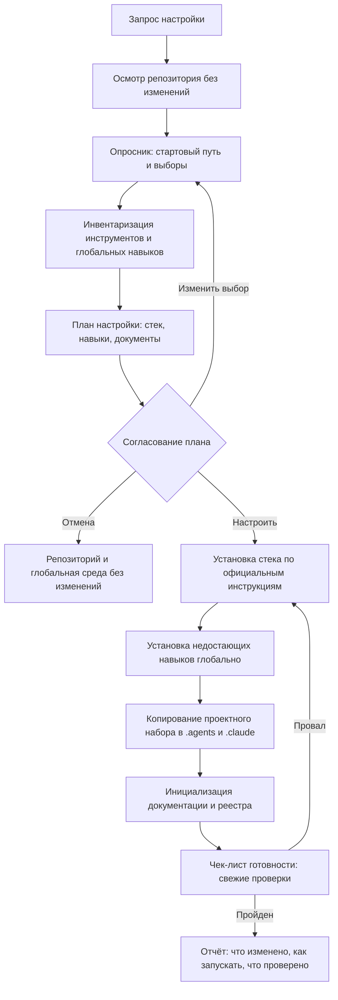

# Go Product Platform — начальная настройка

Платформа — это коллекция Markdown-документов: этот навык, его references и
[каталог навыков платформы](../../../README.md). Исполняемого установщика нет:
последовательность настройки — данные в документах, а выполняет её агент своими
инструментами (файловые операции, git, shell), подтверждая план у пользователя.
Приоритет настройки — прозрачность и лёгкая правка последовательности и объёма
действий, а не точная воспроизводимость.

## Результат

По запросу настройки доведите продукт до запускаемой основы выбранного стека:
правила разработки, документация, проектные навыки, зависимости, локальное
окружение и свежие проверки. Установка одной документации не завершает эту задачу.
Выбранные навыки, агенты и референсы устанавливаются в `.agents/` и `.claude/`
продукта и отслеживаются в Git. Проектные версии имеют приоритет над глобальными.
Состав набора фиксируется в реестре продукта `docs/agent-skills.md`.

## Процесс



## Главный сценарий: один запрос → опрос в чате → настройка

Пользователь открывает **целевой продуктовый репозиторий** и вызывает скилл:

```text
/go-platform-bootstrap Подготовь этот проект к разработке
```

Это обозначение вызова в ADE с поддержкой slash-skills. В Codex используйте нативное
упоминание `$go-platform-bootstrap` или выбор скилла; сценарий после вызова одинаковый.

Для такого запроса **сначала проведите [опросник](references/questionnaire.md)**.
Первый вопрос — «С чего вы хотите начать?»: подготовить проект к разработке без
описания продукта, описать идею или разобрать готовые требования из документов и
ссылок. В последнем случае сначала согласуйте понимание материалов. Все пути
ведут к общей настройке и проверке готовности; явно выбранный путь не спрашивайте снова.
Не требуйте от пользователя знать профиль, команды, пути к установщику или список
навыков. Задавайте по одному вопросу, используйте встроенные варианты ответа ADE,
если доступны, иначе обычный чат. Ждите ответа перед зависимым выбором; не
трактуйте молчание как выбор или одобрение.

Сначала изучите репозиторий без изменений. Ответы, уже содержащиеся в запросе или
коде, подставляйте в рекомендацию, не спрашивайте их повторно. До согласования
итогового плана не создавайте файлы, не устанавливайте инструменты и не меняйте
глобальные навыки. Инвентаризацию глобальных навыков согласуйте в опроснике.
Пользователь отвечает на вопросы и подтверждает человеческое описание плана;
все действия выполняет агент. После подтверждения плана выполните весь разрешённый
объём самостоятельно по разделу «Полная настройка» ниже. Не просите повторно
одобрять те же установки и выбор профиля. При отмене до применения оставьте
репозиторий и глобальную среду без изменений. Если план меняется существенно,
покажите только новые действия для согласования.

## Полная настройка продукта

1. Определите корень Git, прочитайте существующие правила, код, реестр набора
   `docs/agent-skills.md`, `MANUAL.md` и команды разработки, если они
   есть. Сохраните существующие приложения и пользовательские файлы; подготовка
   проекта не означает очистку или замену стека.
2. Пройдите выбранный стартовый путь по [опроснику](references/questionnaire.md).
   Для технической основы не придумывайте бизнес-требования; для готовых требований
   сначала получите подтверждение их понимания и учтите ограничения источников.
   По ответам выберите профиль `go-api`, `web`, `desktop`, `mobile-native`, `ai`
   или `custom`; внутреннее имя профиля пользователь знать не обязан.
   Объясните план: процесс, стек, отсутствующие инструменты, глобальные навыки,
   изменения продукта. Покажите структурированную таблицу: навык, назначение,
   источник, ревизия, пути в `.agents` и `.claude`; отдельно перечислите агентов
   и референсы источников. Получите согласование именно этого набора. Уже данное
   разрешение на установку этого набора достаточно; запрос только на проверку
   не разрешает установку. Новые глобальные обновления и разрушительные действия
   требуют отдельного решения.
3. Прочитайте [подготовку продукта](references/product-setup.md) — критерии,
   составы профилей, официальные инструкции стека и чек-лист инициализации.
   Источники навыков и пути установки — [skill-sources.md](references/skill-sources.md).
   Осмотрите `~/.agents/skills/` и `~/.claude/skills/` (если осмотр согласован) и
   проверьте версии инструментов продукта (`go version`, `node --version`, `uv tool list`
   и т.п.), чтобы использовать существующее и устанавливать только недостающее.
   Сеть и глобальные изменения включите в план.
4. После согласования итогового плана подготовьте недостающие исходники и конфигурацию
   по [product-setup.md](references/product-setup.md) и активным навыкам, адаптируя
   пути к продукту. Для нового продукта используйте официальные генераторы и инструкции
   выбранных версий. Установите весь выбранный стек, а не только skills.
   Существующий UI подключайте; не генерируйте второй поверх него.
   Используйте SDD: requirements → design → plan/tasks → implement → verify → review.
5. Установите недостающие глобальные навыки: клонируйте источники на согласованных
   ревизиях и скопируйте каталоги навыков в `~/.agents/skills/` **и** `~/.claude/skills/`
   по [skill-sources.md](references/skill-sources.md). Существующие навыки не
   перезаписывайте; скрипты сторонних навыков не запускайте. Graphify и Orca
   устанавливаются их собственными официальными механизмами.
6. Скопируйте согласованный набор в продукт: навыки — в `.agents/skills/` и
   `.claude/skills/`, агентов — в `agents/`, референсы и ресурсы — в `references/`
   обоих каталогов. Выполните [инициализацию репозитория](references/product-setup.md#инициализация-репозитория-продукта):
   документация процесса, HLD, `AGENTS.md` и `CLAUDE.md`, `MANUAL.md`, `.gitignore`,
   реестр `docs/agent-skills.md` с ревизиями набора. Отсутствующие
   документы создавайте из [шаблонов платформы](../../templates/); существующий
   пользовательский контент не перезаписывайте.
7. Дополните HLD контекстом продукта и корневой `MANUAL.md`: prerequisites,
   настройка окружения и БД, имена переменных без секретов, установка зависимостей,
   миграции, запуск, тесты и устранение типичных ошибок. Указывайте фактически
   проверенные команды. Дополните `AGENTS.md` и `CLAUDE.md` до основных инструкций
   агента (обязательная структура — в разделе ниже). Создавайте SPEC, ADR,
   контракты и другие документы по необходимости согласно главам 19–20 handbook;
   не выдавайте черновик за согласованную архитектуру.
8. Выполните [чек-лист готовности](references/product-setup.md#критерии-готовности)
   после последних изменений: свежие проверки инструментов, компонентов и запуска.
   Исправьте ошибки, затем повторите проверку. Отдельно проверьте обнаружение
   скилла целевой ADE: каталоги совместимы с Agent Skills, но версия/выбранный
   агент среды могут требовать настройки или перезапуска.
9. Сообщите изменённые файлы, способ запуска и результаты проверок. Если сеть,
   credentials, SDK или инструменты недоступны, перечислите конкретные блокеры;
   не заявляйте готовность. Установка окружения не является выпуском продукта.

## Стандарт и дополнительные компоненты

- Создавайте `AGENTS.md` и `CLAUDE.md` полностью на русском языке: все заголовки,
  пояснения, правила и разделы. Явно требуйте соблюдать процесс разработки из
  software-development-workflow и приоритет проектных навыков. Команды, пути,
  имена файлов, названия продуктов и технические идентификаторы сохраняйте без
  перевода. В существующем продукте переведите также пользовательские разделы,
  сохранив смысл, обязательность и структуру правил; не удаляйте их.
- Вне блока платформы дополните `AGENTS.md` и `CLAUDE.md` до основных инструкций
  агента продукта: правила на каждый запрос — перед сообщением выбирать применимые
  навыки из установленных проектных и сообщать на русском, какие применяются и
  почему (при наличии `using-agent-skills` — начинать с его чтения), таблица
  маршрутизации задач по навыкам для фактического набора, краткий контекст продукта
  (цель, архитектура, данные, UI), конвенции работы, команды проверки или ссылка на
  `MANUAL.md`, раздел навигации Graphify. Полный список устанавливаемых и
  проверяемых навыков — [product-setup.md](references/product-setup.md);
  готовые примеры итоговых файлов —
  [agents-md-example.md](references/agents-md-example.md) и
  [claude-md-example.md](references/claude-md-example.md).
- Каждый продукт использует `docs/workflow.md` и структуру handbook
  19–20. Инварианты — [constitution.md](../../constitution.md). Материалы платформы устанавливаются полным снимком
  в `references/go-product-platform/` соответствующего каталога агента.
  Оба навыка и снимок переносите по
  [правилам упаковки](../../references/bootstrap-installation.md#переносимый-набор-платформы);
  проверяйте ссылки после переноса.
- Graphify входит во все профили, включая custom, и устанавливается официальным
  механизмом (`uv tool install graphifyy`). Orca skills устанавливаются
  собственным механизмом Orca.
- Для UI предложите app-canvas: прочитайте
  [canvas-installation.md](../../references/canvas-installation.md) из материалов
  платформы. Агент сам клонирует и проверяет источник; пользователь подтверждает
  план. Canvas дополняет SPEC, не заменяя инженерную документацию.
- Повторный запрос управления проектом: прочитайте
  `.agents/skills/go-project-platform-manager/SKILL.md` (или тот же файл в `.claude/skills/`).
- Рабочее дерево (worktree) получает отслеживаемые `.agents/` и `.claude/` из Git;
  ничего дополнительно восстанавливать не нужно, кроме генерируемых материалов
  (граф graphify и локальные артефакты), которые каждое дерево строит само.

## Проверки и обновления

Если пользователь просит только проверить, выполните осмотр набора и окружения
(наличие `SKILL.md` всех навыков реестра в `.agents/skills/` и `.claude/skills/`,
ревизии источников, версии инструментов) и завершите отчётом; setup не запускайте.

Для запрошенного обновления навыков: сравните ревизии источников с реестром
продукта, покажите точные изменения (SHA, состав, влияние на другие продукты на
этой машине) и применяйте только после отдельного согласия. Orca/Graphify
обновляются их собственными механизмами отдельно. Сохраняйте прежние снимки до
успешной замены. Подробный порядок —
[go-project-platform-manager](../../project-skill-templates/go-project-platform-manager/SKILL.md).

Проектные копии обновляйте отдельно: после изменения глобального набора покажите
список для согласования, скопируйте одобренное в `.agents/` и `.claude/`, обновите
реестр и закоммитьте каталоги и инструкции. Обновление глобальных навыков само по
себе не изменяет проектные версии.
