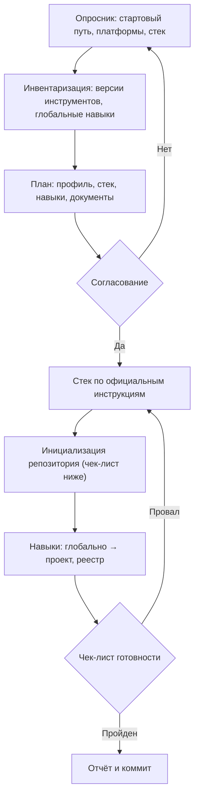
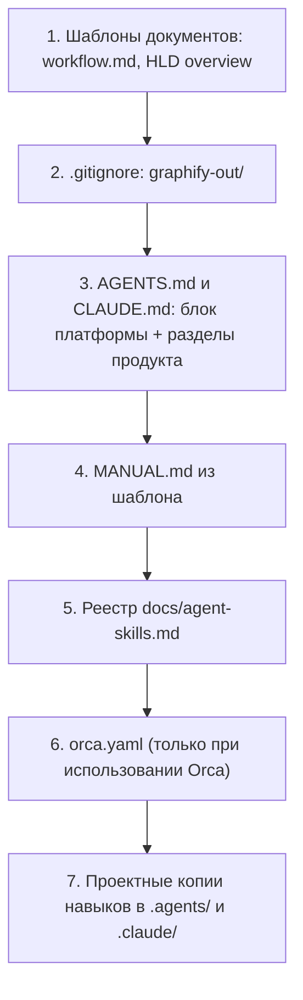

# Подготовка продукта

Настройка — это согласованный агентом план действий: последовательность, объём
и состав описаны в документах и правятся как текст. Приоритет — прозрачность и
лёгкая корректировка, а не точная воспроизводимость. Никаких исполняемых
конфигураций: агент выполняет шаги своими инструментами, пользователь видит и
одобряет план в чате, команды проверок фиксируются в `MANUAL.md` продукта.
Все действия выполняются в корне Git продукта; вне его меняются только
глобальные каталоги навыков после отдельного согласия. В настройку не входят
release/deploy.

## Процесс настройки

## Профили и критерии

Все стартовые пути опросника используют одни критерии готовности. При подготовке
без описания продукта проверяется техническая основа выбранного стека; предметные
функции и бизнес-требования не придумываются. Для идеи или готовых требований
основа учитывает выясненные ограничения, но настройка не означает реализацию
всего продукта. Подтверждение понимания требований предшествует выбору итогового
стека; установка выполняется после согласования конкретного плана настройки.

Составы профилей правятся прямо в этом документе (таблица ниже) — это данные.

| Профиль | Состав навыков (общая основа + дополнения) |
|---|---|
| go-api | [база](#проектный-набор-агентных-материалов) + golang-design-patterns, golang-database, golang-testing, golang-security, go-architecture-review, protobuf, systematic-debugging |
| web | база + golang-design-patterns, golang-database, golang-testing, protobuf, shadcn, react-best-practices, playwright-cli, systematic-debugging |
| desktop | база + golang-design-patterns, golang-testing, protobuf, wails, shadcn, playwright-cli, systematic-debugging |
| mobile-native | база + golang-testing, protobuf, swiftui-expert-skill, swift-concurrency, jetpack-compose-performance, testing-setup |
| ai | база + golang-testing, protobuf, ai-sdk, ai-elements, security-and-hardening |
| custom | база + явно согласованные навыки; технологические исключения фиксируются в workflow |

База каждого профиля — graphify, go-platform-bootstrap, go-project-platform-manager
и восемь навыков процесса ниже. Референсы и шаблоны software-development-workflow
входят во все профили, включая `custom`; custom меняет технологический состав,
но сохраняет обязательный процесс и структуру документации.

Общие компоненты каждого профиля и их проверки:

| Компонент | Что подготовить | Чем подтвердить |
|---|---|---|
| go | Go-модуль, feature-oriented пакеты, entrypoint, тесты | `go test ./...`, `go build ./...` из корня модуля |
| contracts | Protobuf, Buf lint и генераторы Connect, зафиксированные версии | `buf lint`, `buf generate`, сборка полученных контрактов |
| database | PostgreSQL + pgx/sqlc и миграции; для offline desktop — SQLite по HLD | Реальная проверка подключения, применение миграций в отдельной dev/test БД и integration-тест |
| environment | Версии инструментов, env example, команды запуска/остановки, изоляция worktree | Smoke-тест процесса и healthcheck; проверить отдельные порты/БД/logs каждого worktree |

Дополнения по профилям:

| Профиль | Компоненты | Что проверить |
|---|---|---|
| go-api | Общая основа, PostgreSQL | API/integration + модульные тесты |
| web | frontend, ui, e2e | Vite + React + TS; shadcn/Tailwind; production build, typecheck, браузерный smoke с вызовом API |
| ai | web + ai | AI SDK/AI Elements по месту, серверная граница ключей; тест адаптера без секрета, smoke с провайдером при наличии доступа |
| desktop | frontend, ui, e2e, desktop | Wails v3 + React, bindings, SQLite/PG по архитектуре; native build и smoke приложения на целевой ОС |
| mobile-native | mobile | Go API и выбранные SwiftUI/Compose клиенты; SDK, сборка и smoke на симуляторе/эмуляторе выбранной платформы |
| custom | Общая основа + нужные дополнительные компоненты | Адаптации и исключения записать в HLD/workflow, добавить проверки в чек-лист |

Проверки инструментов — минимум; дополните graphify, sqlc, goose, mise, Swift/Xcode,
Android SDK/Gradle и другими фактически выбранными инструментами. Для pg/мобильных
проверок CLI version недостаточно: проверки компонентов должны обращаться к среде.
Зависимость «нужны credentials» нельзя заменить фиктивной зелёной проверкой.

## Установка по официальным инструкциям

Перед выполнением сверить выбранную версию и поддерживаемую ОС; зафиксировать
совместимые версии в mise/go.mod/package manager lock/конфигурации генераторов.
Не копировать патч-версии из старого handbook без проверки доступности.

- [Go modules](https://go.dev/doc/tutorial/create-module): `go mod init <module>`
  только при отсутствии модуля. Идентификатор брать из продукта, не из имени папки.
- [Connect Go](https://connectrpc.com/docs/go/getting-started/) и
  [Buf](https://buf.build/docs/cli/installation/): подготовить .proto и config,
  генерацию Go/Connect; версии plugins фиксировать. Домен не зависит от транспорта.
- [pgx](https://github.com/jackc/pgx), [sqlc](https://docs.sqlc.dev/en/stable/overview/install.html),
  [goose](https://github.com/pressly/goose): БД под отдельной dev-ролью, миграции и
  тестовые данные. Не использовать production URL и привилегии приложения для provisioning.
- [Vite](https://vite.dev/guide/): новый React/TS UI — `pnpm create vite <app> --template react-ts`;
  существующий использовать на месте, затем `pnpm install`, typecheck/build.
- [shadcn Vite](https://ui.shadcn.com/docs/installation/vite): Tailwind, alias,
  components.json и минимальный компонент. По запросу canvas применить утверждённый кит;
  не смешивать киты без архитектурного решения.
- [Wails v3](https://v3.wails.io/getting-started/setup/),
  [CLI](https://v3.wails.io/reference/cli/): установить совместимый wails3,
  проверить локально `wails3 init -l`, выбрать React template и пустой целевой каталог.
  Не предполагать, что шаблон называется react-ts во всех версиях.
- [Playwright](https://playwright.dev/docs/intro): установить выбранные браузеры,
  webServer/baseURL, smoke с реальным приложением и сохранением trace при ошибке.
- [AI SDK](https://ai-sdk.dev/docs/getting-started): установить в нужное TS-приложение,
  выбрать провайдера по запросу; серверный ключ только в окружении.
- Для mobile выбрать только нужную платформу, прочитать официальные SDK instructions
  и глобальные Swift/Compose навыки. Не устанавливать оба SDK без продуктовой причины.

Команды установки должны быть повторяемыми: пропускать уже существующие файлы,
не сбрасывать БД/код/пользовательскую конфигурацию. Секреты — через окружение,
не в Git и не в чат.

## Инициализация репозитория продукта

Последовательность базовой инициализации — чек-лист; агент выполняет шаги в этом
порядке, каждый шаг идемпотентен и сохраняет пользовательский контент. Порядок
и состав правятся как текст прямо здесь. Шаги обязательны, кроме отмеченного
опциональным; исключить шаг может только пользователь в согласованном плане.

1. Документация процесса: если `docs/workflow.md` отсутствует — создать
   из [шаблона](../../../templates/engineering-workflow.md); если `docs/hld/README.md`
   отсутствует — из [шаблона](../../../templates/hld-overview.md). Существующие
   документы не перезаписывать.
2. `.gitignore`: добавить `/graphify-out/` и другие генерируемые артефакты продукта;
   существующие строки не дублировать.
3. `AGENTS.md` и `CLAUDE.md`: блок платформы — из
   [примера](agents-md-example.md); в существующем файле блок обновить, сохранив
   весь пользовательский текст. Полностью на русском.
4. `MANUAL.md`: из [шаблона](../../../templates/manual.md); существующий ручной
   текст сохранить, заполнить фактические команды стека.
5. Реестр набора: `docs/agent-skills.md` из
   [шаблона](../../../templates/agent-skills-registry.md) — профиль, навыки, ревизии,
   агенты и референсы. Это единственное место фиксации состава (замена lock-файла).
6. `orca.yaml`: опционально, только если продукт используется с Orca; в `setup`
   указать команды продукта, а не платформы.
7. Проектные копии согласованного набора: навыки в `.agents/skills/` и `.claude/skills/`,
   агенты в `agents/`, референсы и ресурсы в `references/` обоих каталогов.
   Оба навыка платформы и полный снимок материалов переносить по
   [правилам упаковки](../../../references/bootstrap-installation.md#переносимый-набор-платформы).

## Критерии готовности

Проверки выполняет агент после завершения настройки и по каждому запросу
«проверь готовность»: свежие команды, честные результаты, никакой подмены
зелёными заглушками. Результат — отчёт в чате; для повторяемых проверок команды
должны быть зафиксированы в `MANUAL.md` (раздел «Чек-лист готовности»).

| # | Проверка | Источник истины |
|---|---|---|
| 1 | Инструменты стека установлены и версии согласованы (`go version`, `buf --version`, `node --version`, `uv tool list`, ...) | вывод команд, фиксация в MANUAL |
| 2 | Компонентные проверки из таблицы «Профили и критерии» пройдены фактически | вывод команд |
| 3 | Каждый навык реестра имеет `SKILL.md` в `.agents/skills/` **и** `.claude/skills/` | осмотр каталогов |
| 4 | Реестр `docs/agent-skills.md` соответствует фактическому набору, включая ревизии и пути агентов/референсов | сравнение |
| 4а | База и восемь навыков процесса присутствуют, workflow и upstream SDW читаются; снимок платформы полон, его ссылки работают без исходного клона | состав выше и правила упаковки |
| 5 | `docs/workflow.md`, HLD, `AGENTS.md`, `CLAUDE.md`, `MANUAL.md` на месте; инструкции на русском и требуют workflow | осмотр файлов |
| 6 | Приложение запускается: smoke-запуск и healthcheck | вывод процесса |

Провал любой проверки — блокер: перечислите конкретные причины и недоступности,
не заявляйте готовность. Установка окружения не является выпуском продукта.

## Проектный набор агентных материалов

Состав набора согласуется в чате (таблица: навык, назначение, источник, ревизия,
пути в `.agents` и `.claude`; отдельно агенты и референсы). После согласования
агент копирует материалы в оба каталога продукта; копии и реестр хранятся в Git
и имеют приоритет над глобальными. `MANUAL.md` содержит настройку, окружение,
запуск и проверки конкретного продукта.

### Полный список устанавливаемых и проверяемых навыков

Ссылки ведут на текущую ветку для чтения; при установке фиксируйте ревизию
(SHA; для не-Git снимка — версию или дату с контрольной суммой) в реестре продукта `docs/agent-skills.md`.
Пути внутри репозиториев — [skill-sources.md](skill-sources.md).

База каждого профиля — устанавливается в `.agents/skills/` и `.claude/skills/`
и проверяется чек-листом готовности:

| Навык | Назначение |
|---|---|
| [go-platform-bootstrap](../SKILL.md) | настройка платформы, worktrees, обновление навыков |
| [go-project-platform-manager](../../../project-skill-templates/go-project-platform-manager/SKILL.md) | проверка, выбор и обновление проектного набора |
| [graphify](https://github.com/Graphify-Labs/graphify) | граф исходников и архитектурная навигация |

Процесс `software-development-workflow` — во все профили, включая `custom`. Стандарт
[software-development-workflow](https://github.com/vadagama/software-development-workflow)
ставится референсами и шаблонами в `.agents/references/` и `.claude/references/`;
навыки процесса:

| Навык | Назначение |
|---|---|
| [spec-driven-development](https://github.com/addyosmani/agent-skills/blob/main/skills/spec-driven-development/SKILL.md) | требования → дизайн → план |
| [planning-and-task-breakdown](https://github.com/addyosmani/agent-skills/blob/main/skills/planning-and-task-breakdown/SKILL.md) | декомпозиция задач |
| [incremental-implementation](https://github.com/addyosmani/agent-skills/blob/main/skills/incremental-implementation/SKILL.md) | пошаговая реализация |
| [test-driven-development](https://github.com/addyosmani/agent-skills/blob/main/skills/test-driven-development/SKILL.md) | тесты до реализации |
| [code-review-and-quality](https://github.com/addyosmani/agent-skills/blob/main/skills/code-review-and-quality/SKILL.md) | ревью и качество |
| [documentation-and-adrs](https://github.com/addyosmani/agent-skills/blob/main/skills/documentation-and-adrs/SKILL.md) | документация и ADR |
| [context-engineering](https://github.com/addyosmani/agent-skills/blob/main/skills/context-engineering/SKILL.md) | контекст агента |
| [git-workflow-and-versioning](https://github.com/addyosmani/agent-skills/blob/main/skills/git-workflow-and-versioning/SKILL.md) | ветки, коммиты, версии |

Профильные дополнения:

| Навык | Назначение | В профилях |
|---|---|---|
| [golang-design-patterns](https://github.com/samber/cc-skills-golang/blob/main/skills/golang-design-patterns/SKILL.md) | идиоматичный Go, композиция, минимум лишних интерфейсов | go-api, web, desktop |
| [golang-database](https://github.com/samber/cc-skills-golang/blob/main/skills/golang-database/SKILL.md) | PostgreSQL, `pgx`, транзакции, пулы, миграции | go-api, web |
| [golang-testing](https://github.com/samber/cc-skills-golang/blob/main/skills/golang-testing/SKILL.md) | модульные, интеграционные и табличные тесты, фаззинг | go-api, web, desktop, mobile-native, ai |
| [golang-security](https://github.com/samber/cc-skills-golang/blob/main/skills/golang-security/SKILL.md) | границы доверия, инъекции, секреты, обработка ввода | go-api |
| [go-architecture-review](https://github.com/eduardo-sl/go-agent-skills/blob/main/skills/%28architecture%29/go-architecture-review/SKILL.md) | аудит границ, владения и зависимостей модулей | go-api |
| [protobuf](https://github.com/bufbuild/claude-plugins/blob/main/plugins/protobuf/skills/protobuf/SKILL.md) | `.proto`, Buf lint/generate, контракты Connect/gRPC | go-api, web, desktop, mobile-native, ai |
| [systematic-debugging](https://github.com/obra/superpowers/blob/main/skills/systematic-debugging/SKILL.md) | поиск первопричины сбоя, а не симптома | go-api, web, desktop |
| [shadcn](https://github.com/shadcn-ui/ui/blob/main/skills/shadcn/SKILL.md) | подбор и настройка UI-компонентов, дизайн-токены | web, desktop |
| [react-best-practices](https://github.com/vercel-labs/agent-skills/blob/main/skills/react-best-practices/SKILL.md) | лишние рендеры, размер бандла, задержки React | web |
| [playwright-cli](https://github.com/microsoft/playwright-cli/blob/main/skills/playwright-cli/SKILL.md) | агентное браузерное E2E, трассировки и снимки | web, desktop |
| [wails](https://github.com/spf13/go-skills/blob/main/wails/SKILL.md) | Go↔JS bindings, окна и сборка desktop (адаптировать под v3) | desktop |
| [swiftui-expert-skill](https://github.com/AvdLee/SwiftUI-Agent-Skill/blob/main/skills/swiftui-expert-skill/SKILL.md) | SwiftUI: состояние, навигация, доступность | mobile-native |
| [swift-concurrency](https://github.com/AvdLee/Swift-Concurrency-Agent-Skill/blob/main/skills/swift-concurrency/SKILL.md) | акторы, `Sendable`, структурированная конкурентность | mobile-native |
| [jetpack-compose-performance](https://github.com/android/skills/blob/main/jetpack-compose/jetpack-compose-performance/SKILL.md) | повторная композиция, списки и плавность Compose | mobile-native |
| [testing-setup](https://github.com/android/skills/blob/main/testing/testing-setup/SKILL.md) | тестовое окружение Android, эмулятор/устройство | mobile-native |
| [ai-sdk](https://github.com/vercel/ai/blob/main/skills/use-ai-sdk/SKILL.md) | Vercel AI SDK: tools, агентные циклы, стриминг | ai |
| [ai-elements](https://github.com/vercel/ai-elements/blob/main/skills/ai-elements/SKILL.md) | UI чата, tool calls и ввод для shadcn | ai |
| [security-and-hardening](https://github.com/addyosmani/agent-skills/blob/main/skills/security-and-hardening/SKILL.md) | усиление безопасности приложения | ai |

`custom` использует только базу выше плюс явно согласованные навыки.

Полный каталог источников — репозитории, пути в клоне, способ установки —
ведётся в [skill-sources.md](skill-sources.md).

Рекомендуемое дополнение для правила AGENTS.md «каждый запрос» —
[using-agent-skills](https://github.com/addyosmani/agent-skills/blob/main/skills/using-agent-skills/SKILL.md)
(чтение в начале запроса и выбор применимых навыков). Опционально по продукту:
семь [Orca skills](https://github.com/stablyai/orca) — `orca-cli` (окна, worktrees,
окружения), `orchestration` (несколько агентов и задач), `computer-use`
(desktop-интерфейсы), `orca-linear` (задачи Linear), `orca-emulator`
(iOS Simulator), `orca-emulator-android` (Android Emulator),
`orca-per-workspace-env` (изоляция окружения worktree); UI
[canvas](https://gitlab16.skiftrade.kz/design/app-canvas) (отдельная установка);
прочие навыки каталога [skill-sources.md](skill-sources.md) по согласованию
в чате.
