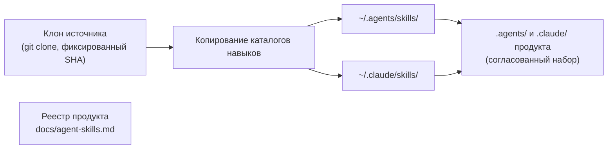

# Каталог источников навыков

Единственный источник истины о том, откуда брать навыки, агентов и референсы.
Это данные, а не код: чтобы добавить источник или путь — дополните таблицу и
перечислите изменение в плане согласования. Ревизии (commit SHA) фиксируются
не здесь, а в реестре набора продукта `docs/agent-skills.md` после
каждой установки.

Установка выполняет агент: клонировать источник в общую временную папку,
скопировать нужные каталоги в `~/.agents/skills/` **и** `~/.claude/skills/`
(оба каталога всегда), не перезаписывать существующие навыки без отдельного
решения пользователя, скрипты сторонних навыков не запускать.

## Источники навыков

| Источник | Репозиторий | Навыки: путь в клоне | Референсы и ресурсы |
|---|---|---|---|
| addyosmani | https://github.com/addyosmani/agent-skills | `skills/<имя>` для: spec-driven-development, test-driven-development, incremental-implementation, code-review-and-quality, code-simplification, source-driven-development, security-and-hardening, planning-and-task-breakdown, context-engineering, api-and-interface-design, debugging-and-error-recovery, git-workflow-and-versioning, constraint-driven-development, documentation-and-adrs, using-agent-skills, interview-me, idea-refine, doubt-driven-development, frontend-ui-engineering, browser-testing-with-devtools, performance-optimization, accessibility-engineering, ci-cd-and-automation, deprecation-and-migration, observability-and-instrumentation, shipping-and-launch | `references/` — общие референсы |
| superpowers | https://github.com/obra/superpowers | `skills/verification-before-completion`, `skills/systematic-debugging`, `skills/using-git-worktrees` | — |
| samber-go | https://github.com/samber/cc-skills-golang | `skills/golang-design-patterns`, `skills/golang-database`, `skills/golang-testing`, `skills/golang-concurrency`, `skills/golang-security` | — |
| go-architecture | https://github.com/eduardo-sl/go-agent-skills | `skills/(architecture)/go-architecture-review` | — |
| buf-protobuf | https://github.com/bufbuild/claude-plugins | `plugins/protobuf/skills/protobuf` | — |
| wails | https://github.com/spf13/go-skills | `wails` | — |
| shadcn | https://github.com/shadcn-ui/ui | `skills/shadcn` | — |
| vercel-react | https://github.com/vercel-labs/agent-skills | `skills/react-best-practices`, `skills/composition-patterns`, `skills/web-design-guidelines` | — |
| tanstack-query | https://github.com/axross/skills | `skills/tanstack-query-development` | — |
| tailwind-design | https://github.com/wshobson/agents | `plugins/frontend-mobile-development/skills/tailwind-design-system` | — |
| microsoft-playwright | https://github.com/microsoft/playwright-cli | `skills/playwright-cli` | — |
| microsoft-accessibility | https://github.com/microsoft/a11y-llm-eval | `config/skills/building-accessible-ui` | — |
| vercel-ai | https://github.com/vercel/ai | `skills/use-ai-sdk` | — |
| vercel-ai-elements | https://github.com/vercel/ai-elements | `skills/ai-elements` | — |
| swiftui | https://github.com/AvdLee/SwiftUI-Agent-Skill | `skills/swiftui-expert-skill` | — |
| swift-concurrency | https://github.com/AvdLee/Swift-Concurrency-Agent-Skill | `skills/swift-concurrency` | — |
| android | https://github.com/android/skills | `jetpack-compose/jetpack-compose-performance`, `testing/testing-setup` | — |
| oauth | https://github.com/citypaul/.dotfiles | `claude/.claude/skills/secure-oauth-oidc` | — |
| openbao | https://github.com/Getty/p5-www-openbao | `.claude/skills/openbao-general` | — |

## Стандарт процесса (особый источник)

| Источник | Репозиторий | Что устанавливать | Куда |
|---|---|---|---|
| software-development-workflow | https://github.com/vadagama/software-development-workflow | `docs/`, `templates/`, `examples/` с сохранением имён подкаталогов | `.agents/references/software-development-workflow/{docs,templates,examples}/` и `.claude/references/software-development-workflow/{docs,templates,examples}/` |

## Отдельно устанавливаемые инструменты с навыками

| Навык/инструмент | Источник | Способ установки |
|---|---|---|
| graphify | https://github.com/Graphify-Labs/graphify | `uv tool install graphifyy`; навык — по инструкции репозитория в оба глобальных каталога |
| Orca-навыки (orca-cli, orchestration, computer-use, orca-linear, orca-emulator, orca-emulator-android, orca-per-workspace-env) | https://github.com/stablyai/orca | Собственный механизм Orca; не копировать вручную |
| app-canvas | https://gitlab16.skiftrade.kz/design/app-canvas | По [canvas-installation.md](../../../references/canvas-installation.md) из материалов платформы |

## Правила

- Пути в таблице — относительно корня клона. Имя установки обычно совпадает с каталогом;
  для `skills/use-ai-sdk` имя установки — `ai-sdk`, как в профиле. Проверяйте `name`
  в SKILL.md; расхождения имён явно фиксируйте в плане и реестре.
- Перед копированием убедитесь, что каталог содержит `SKILL.md`.
- Пин ревизии: записывайте в реестр продукта SHA и источник; для не-Git снимка — версию или дату вместе с контрольной суммой.
- Конфликт имён: существующий навык не перезаписывается; новое имя или явное
  решение пользователя.
- Обновления глобальных копий затрагивают все продукты на машине — отдельное
  согласование; проектные копии обновляются независимо.
