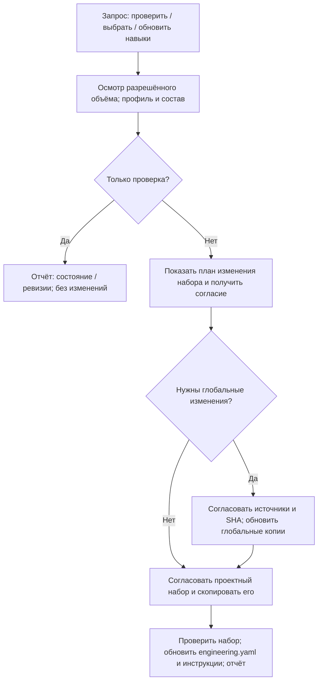

# Go Product Platform — управление навыками проекта

Этот навык установлен в `.agents/skills` и `.claude/skills` продукта. Проектные
навыки, роли и референсы отслеживаются в Git и имеют приоритет над глобальными
версиями. Обязательно соблюдайте процесс разработки продукта из
`.agents/references/docs/workflow.md`.

Состав набора фиксирует `engineering.yaml` в корне продукта, а все действия (осмотр,
копирование, обновление, запуск согласованных скриптов) выполняет агент своими
инструментами; каждый выбор пользователь делает на гейтах согласования
([agent-interaction.md](references/agent-interaction.md)) и не настраивает проект
в консоли вручную.

## Цикл работы с набором

## Работа через агента (пользователь не вводит команды оболочки)

Сценарий работы — чтение engineering.yaml, гейты G1–G6 с фиксированными
вариантами ответа, шаблоны таблиц, проверка результата и итоговый отчёт —
полностью описан в [agent-interaction.md](references/agent-interaction.md).
Выполняйте его целиком своими инструментами: агент показывает варианты
на каждом гейте и дожидается ответа. Для запроса только на проверку
выполняйте лишь чтение и отчёт: гейты установки и обновления пропускаются.

## Правила

- **Никогда** не обновляйте, не заменяйте, не удаляйте и не активируйте навыки без
  уведомления пользователя. Простая просьба *проверить* не разрешает установку
  или обновление.
- Активация для проекта — это изменение engineering.yaml
  и копирование файлов в `.agents/` и `.claude/`; глобальные каталоги меняются
  только отдельным решением.
- Не публикуйте предметные навыки проекта глобально без отдельного явного запроса.
- Никогда не запускайте неизвестные сторонние скрипты навыков автоматически и не
  передавайте им секреты рабочей среды.
- Отслеживаемые файлы `AGENTS.md` / `CLAUDE.md` — точка обнаружения навыка.
  Проектные копии не зависят от последующих глобальных обновлений.
- Работа в новом worktree не требует установки: `.agents/` и `.claude/`
  отслеживаются Git. Восстановите только генерируемые материалы (граф graphify),
  которые каждое дерево строит само.

## SDD и документация продукта

Для полной настройки стека используйте глобальный `go-platform-bootstrap`.
Критерии готовности и составы профилей —
[SKILL.md](../go-platform-bootstrap/SKILL.md#критерии-готовности)
и [профили](../go-platform-bootstrap/references/skill-sources.md#профили-и-критерии);
проверки выполняет агент по чек-листу готовности с фактическими командами
продукта. Уже разрешённый пользователем план не требует повторного подтверждения
каждого входящего в него действия.

## Обязательная основа и выбор инструментов UI

- Graphify из https://github.com/Graphify-Labs/graphify — навык по умолчанию для
  любого проекта, включая custom. При настройке включить его в предлагаемый набор
  и установить отсутствующий глобально (`uv tool install graphifyy`).
  Завершить интеграцию по [инструкции Graphify](../../references/graphify-installation.md):
  область анализа, первоначальный граф, хуки с сохранением Canvas, инструкции
  агента и проверка обновления. Для существующего продукта выявить и устранить
  незавершённые шаги в рамках разрешённой настройки. При «только проверить»
  сообщить пробелы без изменений. В новом worktree восстановить локальный граф
  и проверить эффективные хуки; при разработке поддерживать актуальность.
- Для UI предложить `canvas`, `prototype`, `none` или явно `both`. Для prototype
  читать [prototyping-installation.md](../../references/prototyping-installation.md):
  навыки устанавливаются сразу в проект; глобальная установка не обязательна.
  Приложение размещается в `prototype/`, если его создание входит в план.
- При явном запросе убрать/заменить canvas выполнить
  [миграцию на прототипы](../../references/prototyping-installation.md#замена-canvas-на-прототипы):
  инвентаризация → перенос и проверка замены → удаление по разрешённому плану →
  проверка Graphify и приложения. Одна смена режима не означает удаления.
- При выборе canvas предложить app-canvas из https://gitlab16.skiftrade.kz/design/app-canvas.
  Читать [canvas-installation.md](../../references/canvas-installation.md) в материалах
  платформы. После проверки локального клона и согласования плана агент сам
  создаёт `.canvas/` и `design/`; для существующего приложения подключает его без
  генерации нового. Проверить `.canvas/board.py doctor`.
  Дизайн-пакет `design/` дополняет SPEC продукта; не заменять им инженерную документацию.

Обновляйте корневой MANUAL.md с фактическими командами настройки, запуска и проверок;
проверьте AGENTS.md и CLAUDE.md: русское обязательное указание
процесса разработки и проектных навыков.
